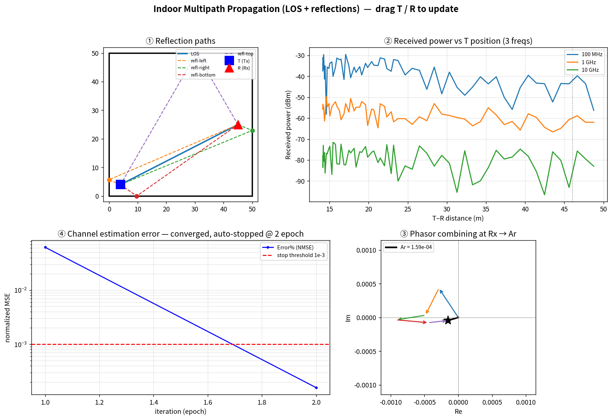
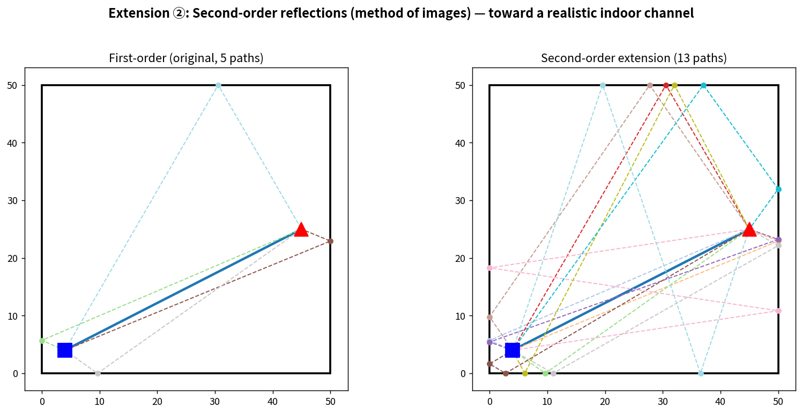
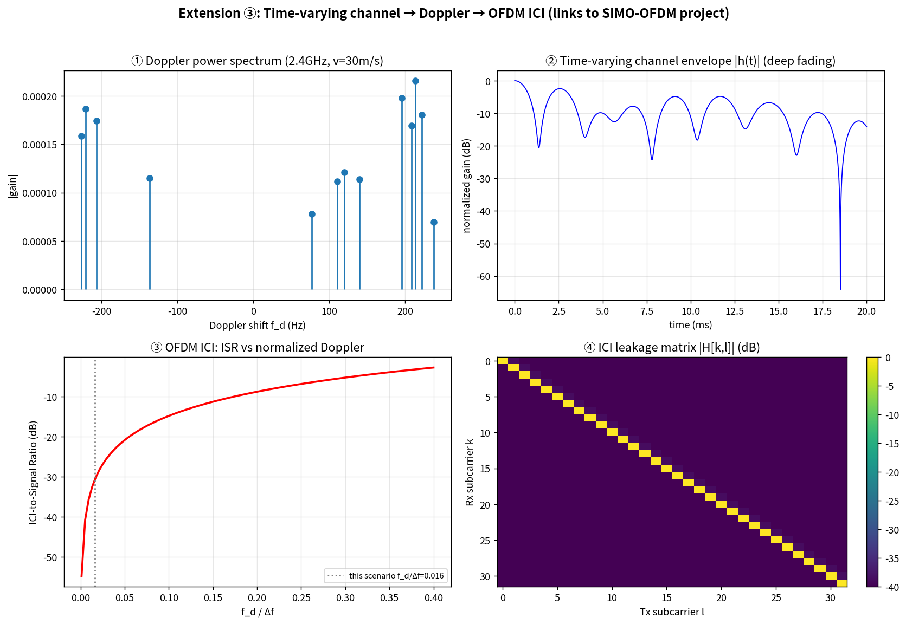
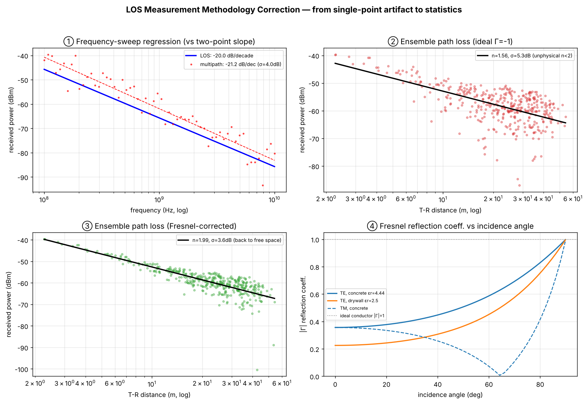

# Indoor Multipath Propagation Simulator

**English** | [繁體中文](README_zh.md)

A simulator for indoor wireless channels based on the **method of images**:
geometric tracing of **LOS + wall-reflection paths**, complex phasor combining,
frequency-dependent path loss, adaptive channel estimation, and a packet-energy
model. Includes two extensions: **second-order reflections** and a
**time-varying channel / OFDM ICI** analysis.

Three interfaces are provided: a pure-Python CLI, an interactive matplotlib GUI,
and a zero-install **browser demo**.



---

## Background & Originality Statement

This project originates from a group term project for a *Wireless Communication
Computer Simulation* course. The original MATLAB code is the joint work of the
group; I am not the first author and do not hold usage rights to that source.
Therefore this repository contains **no original source code**. Instead, it is an
independent, from-scratch Python reimplementation based on the **physical models
described** in the publicly available written report and slides, with extensions
that were not part of the original project:

- **Second-order reflections** (recursive method of images) — expanding from 5
  first-order paths to 13 paths
- **Time-varying channel / Doppler / OFDM ICI** — sharing the same ICI theory as
  a separate SIMO-OFDM project
- **Browser demo** — core physics rewritten in pure JavaScript, draggable with
  no installation required

What is reproduced is the physics and the algorithms, not the code.

---

## Quick Start

```bash
pip install -r requirements.txt

python run.py paths    --tx 4 4 --rx 45 25 --order 2   # list all propagation paths
python run.py power    --rx 45 25                       # received power at 3 frequencies
python run.py estimate                                  # NLMS channel-estimation convergence
python run.py packet                                    # packet energy / node lifetime
python run.py doppler  --vx 30 --freq 2.4e9 --order 2   # Doppler shifts
python run.py gui                                       # interactive 4-quadrant GUI
python run.py snapshot --out main.png                   # static snapshot (headless)
```

Browser version: simply open [`web/index.html`](web/index.html) in a browser and
drag T / R to update in real time.

---

## Four-Quadrant Main View

| Quadrant | Content | Physics |
|----------|---------|---------|
| ① Reflection paths | Geometric T→wall→R paths and reflection points | Method of images |
| ② Power decay | Received power vs. distance at 100MHz/1GHz/10GHz | Friis path loss |
| ③ Phasor combining | Per-path complex fields chained into total field Ar | Multipath interference |
| ④ Channel estimation | NLMS error convergence, auto-stop below 1e-3 | Adaptive filtering |

---

## Extensions

### ② Second-Order Reflections


### ③ Time-Varying Channel → Doppler → OFDM ICI


---

## Measurement Methodology

Path-loss and frequency-roll-off figures are reported as **regression slopes
with residual spread** and **ensemble statistics over random T/R placements**,
not single-point slopes — a single configuration lands in a deep-fade null and
is not representative.



- **Frequency sweep:** LOS roll-off regresses to exactly −20.0 dB/decade (Friis);
  full multipath is −21.2 dB/decade with ~4 dB shadowing spread about the trend.
- **Ensemble path-loss exponent:** an ideal reflection coefficient (Γ=−1) yields
  an unphysical n = 1.6 (lossless walls inject energy); switching to angle-dependent
  **Fresnel** coefficients (concrete εr=4.44) restores n ≈ 2.0 with lower spread.
- **Validity:** geometric-optics + smooth-wall Fresnel holds where surface
  roughness ≪ λ; at 10 GHz (λ=3 cm) roughness, penetration and diffraction are
  no longer negligible, so those results are trend-level only.

See [`docs/METHODOLOGY.md`](docs/METHODOLOGY.md) · run `python run.py measure`.

---

## Project Structure

```
los-multipath-sim/
├── run.py                 # Unified CLI entry point
├── src/
│   ├── geometry.py        # Method of images, 1st/2nd-order reflections
│   ├── channel.py         # Friis path loss, phasor combining, power sweep
│   ├── estimation.py      # NLMS channel estimation
│   ├── packet.py          # WSN packet-energy model
│   ├── timevarying.py     # Doppler, time-varying channel, OFDM ICI
│   ├── measurement.py     # Regression / ensemble path-loss + Fresnel
│   └── gui.py             # Interactive 4-quadrant matplotlib GUI
├── web/index.html         # Zero-install browser demo
├── examples/              # Figure-generation scripts
├── docs/THEORY.md         # Full physics derivations
├── docs/METHODOLOGY.md    # Measurement methodology corrections
└── assets/                # Showcase figures
```

For detailed formulas, see [`docs/THEORY.md`](docs/THEORY.md);
for the measurement corrections, [`docs/METHODOLOGY.md`](docs/METHODOLOGY.md).

---

## Technical Highlights

- **Recursive method of images** handles arbitrary-order reflections,
  back-tracing each reflection point and validating geometric feasibility.
- **NLMS** replaces plain LMS; the normalized step size ensures numerical
  stability (plain LMS diverges at tap gains on the ~1e-3 scale).
- **Doppler → ICI** derivation cross-references the SIMO-OFDM project,
  demonstrating one theory applied across different channel models.
- **Dual Python / JS implementation** with consistent results (matching Prx at
  identical coordinates).

## License

MIT © 2026 Shang-En Hsu (徐上恩)
