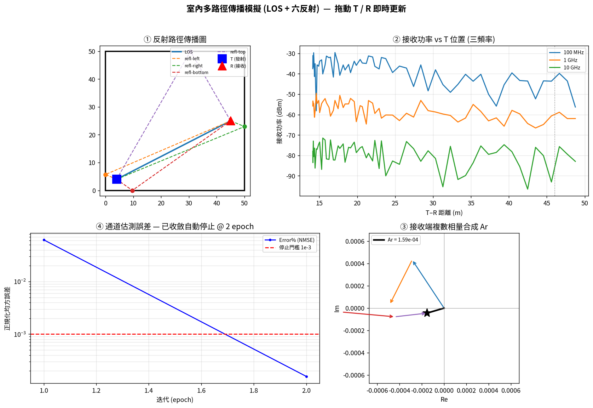
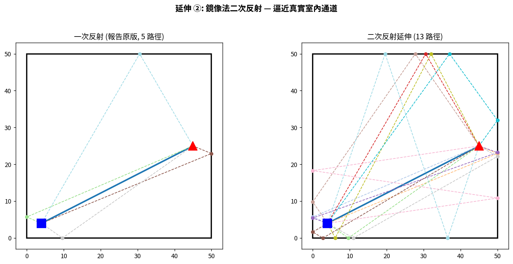
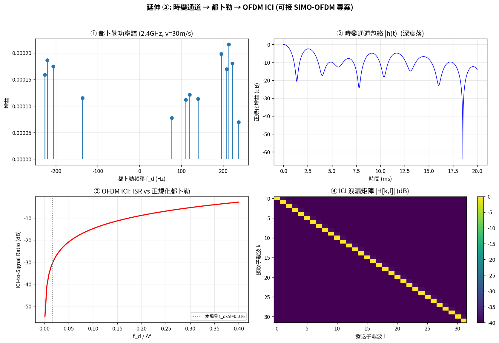

# 室內多路徑傳播模擬器 (Indoor Multipath Propagation Simulator)

[English](README.md) | **繁體中文**

以鏡像法 (method of images) 模擬室內無線通道:**LOS + 牆面反射路徑**的幾何
追蹤、複數相量合成、頻率相依功率衰減、自適應通道估測,以及封包傳輸能量模型。
另含**二次反射**與**時變通道 / OFDM ICI** 兩項延伸。

提供三種介面:純 Python CLI、matplotlib 互動 GUI、以及零安裝的**瀏覽器互動版**。



---

## 緣起與原創性聲明

本專案源自《無線通訊電腦模擬實習》期末小組專題。原專題的 MATLAB 程式碼為
小組共同著作,本人並非第一作者、亦無原始碼使用權。因此本 repository **不含
任何原始程式碼**,而是依據公開的書面報告與簡報所描述的**物理模型概念**,
以 Python 從零獨立重新實作,並額外加入原專題沒有的延伸功能:

- **二次反射** (鏡像法遞迴) — 從一次反射 5 路徑擴充到 13 路徑
- **時變通道 / 都卜勒 / OFDM ICI** — 與另一個 SIMO-OFDM 專案的 ICI 理論同源
- **瀏覽器互動版** — 純 JS 重寫核心物理,無需安裝即可拖動展示

重現的是物理與演算法,不是程式碼。

---

## 快速開始

```bash
pip install -r requirements.txt

python run.py paths    --tx 4 4 --rx 45 25 --order 2   # 列出所有傳播路徑
python run.py power    --rx 45 25                       # 三頻率接收功率
python run.py estimate                                  # NLMS 通道估測收斂
python run.py packet                                    # 封包能量/壽命
python run.py doppler  --vx 30 --freq 2.4e9 --order 2   # 都卜勒頻移
python run.py gui                                       # 互動四象限 GUI
python run.py snapshot --out main.png                   # 無頭環境輸出快照
```

瀏覽器版:直接用瀏覽器開啟 [`web/index.html`](web/index.html),拖動 T / R 即時更新。

---

## 四象限主畫面

| 象限 | 內容 | 物理 |
|------|------|------|
| ① 反射路徑圖 | T→牆面反射→R 的幾何路徑、反射點 | 鏡像法 |
| ② 功率衰減 | 100MHz/1GHz/10GHz 接收功率 vs 距離 | Friis 路徑損耗 |
| ③ 相量合成 | 各路徑複數場首尾相接 → 總場 Ar | 多路徑干涉 |
| ④ 通道估測 | NLMS 誤差收斂,< 1e-3 自動停止 | 自適應濾波 |

---

## 延伸功能

### ② 二次反射


### ③ 時變通道 → 都卜勒 → OFDM ICI


---

## 專案結構

```
los-multipath-sim/
├── run.py                 # 統一 CLI 入口
├── src/
│   ├── geometry.py        # 鏡像法,一次/二次反射
│   ├── channel.py         # Friis 路徑損耗、相量合成、功率掃描
│   ├── estimation.py      # NLMS 通道估測
│   ├── packet.py          # WSN 封包能量模型
│   ├── timevarying.py     # 都卜勒、時變通道、OFDM ICI
│   └── gui.py             # matplotlib 互動四象限 GUI
├── web/index.html         # 零安裝瀏覽器互動版
├── examples/              # 圖表生成腳本
├── docs/THEORY.md         # 完整物理推導
└── assets/                # 展示圖
```

詳細公式見 [`docs/THEORY.md`](docs/THEORY.md)。

---

## 技術重點

- **鏡像法遞迴**處理任意階反射,逐段回推反射點並驗證幾何有效性
- **NLMS** 取代裸 LMS,正規化步長確保數值穩定(裸 LMS 在 tap 增益 ~1e-3
  尺度下會發散)
- **都卜勒 → ICI** 推導與 SIMO-OFDM 專案交叉引用,展示同一套理論在不同
  通道模型上的應用
- Python / JS **雙實作**,數值一致(同座標下 Prx 相符)

## License

MIT © 2026 徐上恩 (Shang-En Hsu)
