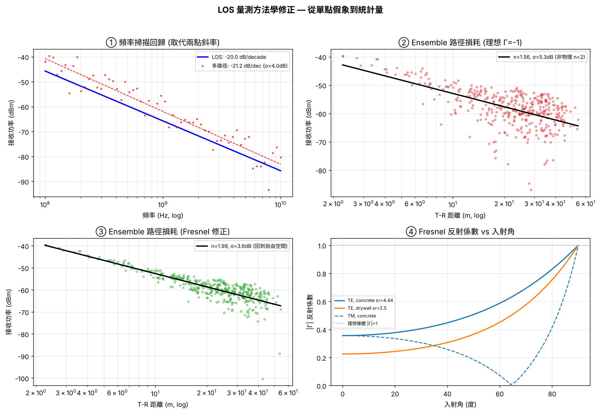

# 量測方法學修正 (Measurement Methodology)

本文件記錄 LOS / 路徑損耗量測從早期「單點斜率」升級為「統計量測」的修正過程,
對應 `src/measurement.py` 與 `examples/make_methodology_figs.py`。



---

## 問題:兩點斜率是取樣假象

早期版本用三個頻率點 (100 MHz / 1 GHz / 10 GHz) 的接收功率拉斜率:

| 區間 | 斜率 |
|------|------|
| 100 MHz → 1 GHz | 34.1 dB/decade |
| 1 GHz → 10 GHz | 4.3 dB/decade |

同一次模擬、相鄰兩個 decade,斜率差 8 倍。這不是物理,而是**多路徑深衰落
剛好砸在 1 GHz 那個點上** —— 用落在衰落谷的單點去定義 per-decade 斜率,方法本身就錯。

---

## 修正 1:頻率掃描 + 線性回歸

改為在 100 MHz–10 GHz 對 log₁₀(f) 密採樣 (60 點) 後線性回歸:

- **LOS only:** 斜率 = −20.00 dB/decade,殘差 σ = 0.00 dB
  → 精確吻合 Friis 自由空間理論 (功率 ∝ (c/4πdf)²,對頻率 −20·log₁₀f)
- **全多路徑:** 斜率 = −21.2 dB/decade,殘差 σ ≈ 4.0 dB
  → 真正趨勢是 ~20 dB/decade,34 是離群值;4 dB 殘差對應多路徑 shadowing

**結論:報「斜率 ± 殘差」,而非單段斜率。**

---

## 修正 2:距離損耗指數 n 與頻率分離

路徑損耗對**距離**與對**頻率**是兩件事,早期混在一起。分離掃描:

- 固定頻率,T 沿一方向遠離 R,對 log₁₀(d) 回歸:Prx = −10·n·log₁₀(d) + c
- LOS: n = 2.00 (Friis 理論值)

距離損耗指數 n 的文獻範圍:自由空間 n=2,市區 n≈2.7–3.5,室內 NLOS n≈3–5。

---

## 修正 3:多組態 ensemble 統計

單一 T/R 會踩到特定衰落谷,無代表性。改為隨機抽樣數百組 (T, R),
對整個 ensemble 回歸求平均 n 與 shadowing σ:

| 反射係數模型 | 路徑損耗指數 n | shadowing σ |
|-------------|--------------|-------------|
| 理想 Γ = −1 | 1.56 | 5.3 dB |
| Fresnel (εr=4.44) | **1.99** | 3.6 dB |

理想 Γ=−1 得到 **n < 2 (非物理)**,因為無損反射在近距離灌入過多能量,
系統性低估路徑損耗。

---

## 修正 4:Fresnel 反射係數與頻率適用性

理想導體 Γ=−1 高估反射能量。改用介電質 Fresnel 反射係數
(混凝土 εr≈4.44),依每條反射路徑的實際入射角計算:

| 入射角 | \|Γ_TE\| (混凝土) | 理想導體 |
|--------|------------------|----------|
| 0° (垂直) | 0.36 | 1.0 |
| 45° | 0.48 | 1.0 |
| 85° (掠射) | 0.91 | 1.0 |

- 真實牆面 |Γ| < 1,僅掠射時趨近 1
- TM 偏振在布魯斯特角 (εr=4.44 時 ≈ 64.6°) 反射係數歸零
- 套用 Fresnel 後 ensemble n 回升至 1.99,模型自洽

**頻率適用性:** 本模型用幾何光學 (鏡像法) + 平滑牆面 Fresnel,適用於牆面
粗糙度 ≪ 波長的頻段。10 GHz (λ=3 cm) 下牆面粗糙度、穿透、繞射不可忽略,
理想鏡面假設開始失效,結果僅供趨勢參考。

---

## 使用

```bash
python src/measurement.py              # 跑完整方法學驗證
python examples/make_methodology_figs.py [--lang en]   # 生成四象限圖
```

## 參考

- T. S. Rappaport, *Wireless Communications: Principles and Practice*, 2/e (Ch. 4)
- A. Goldsmith, *Wireless Communications* (path loss & shadowing models)
- Fresnel equations — any EM textbook (e.g. Balanis, *Advanced Engineering EM*)
